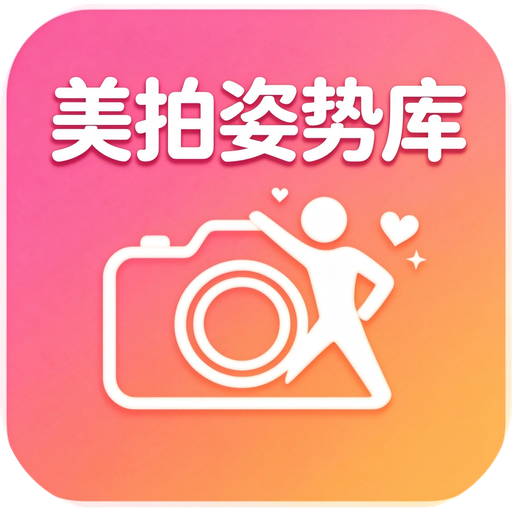

<p align="center">
  
</p>

<h1 align="center">PoseLib</h1>

<p align="center"><b>Stop feeling awkward in front of the camera and keep every good moment!</b></p>

<p align="center">
  <a href="README.md">中文</a> | English
</p>

<p align="center">
  
  
  
  
</p>

---

## Overview

**PoseLib** is an offline Android pose-reference app for people who do not know how to pose, or feel stiff when facing the camera. Open the app, choose a reference photo, copy the person's stance, hand position, camera height, and how much of the frame the person occupies, then take the shot.

Only the Android version is maintained. iOS / Apple projects and IPA builds are no longer supported.

- Current version: **V1.0.15** (`versionCode 1015`)
- Package name: `com.poselib.app`
- Built-in library: **1760** pose photos, **21** top-level categories, 23 category covers, 8 tip images
- APK size: about **302 MB**; the image library is bundled locally, so the APK is large
- Minimum system: Android 5.0 (API 21); portrait only

## Download

> Android APK only. Current version is V1.0.15. Photos are bundled locally, so the APK is about 302 MB.

- Baidu Netdisk: [PoseLib](https://pan.baidu.com/s/5gZ0hq4QQPHVSmFj_XYwnnA)
- Quark Netdisk: [PoseLib V1.0.15](https://pan.quark.cn/s/a49b40ed7f70)

If a netdisk link expires, please report it in Issues.

## Features

### Photos and categories

- Dual entries: **Quick categories** and **Full categories**. Quick categories are shown by default. The two groups keep independent sorting, hiding, and restore display.
- Home shows category covers in a three-column grid. The category grid supports **2 / 3 / 4 / 5 / 6** columns; the default is 2 columns.
- Photos are not compressed and thumbnails are not generated in the source library. Grid views sample decoded images on demand; high-definition images load when opened, with adjacent images preloaded.
- Large photo view: swipe left/right to switch photos, pinch to zoom, double-click to zoom/restore. When zoomed out, horizontal swipe switches photos; when zoomed in, horizontal swipe drags the detail view.
- Bottom actions: favorite, mirror, learned, save, share, delete. Mirror flips the photo left/right for use in front of a mirror.
- Each photo only shows a short tip and one-sentence shooting advice; no difficulty star rating and no countdown.

### Learning and stats

- Favorites, recent history, and learned list are kept separately; recent history keeps the latest **20** entries.
- Daily check-in records whether you opened the app today and the consecutive-day count.
- The stats page shows viewed photos, favorite count, most-used category, zoom count, total usage time, longest single session, and learned count.
- Activity score is calculated from browsing, learned poses, consecutive check-ins, usage time, and feedback count; feedback contributes to the activity score.
- Anonymous stats track open count, active users, and rough rank. The device only stores a random anonymous ID; no phone number, photos, or personal identity information are collected.

### Content and tools

- **Random pose**: draws only from solo, outdoor, indoor, photo style, camera angle, and scene-purpose categories.
- **Search**: search by category name and photo title.
- **Shooting tips**: 8 illustrated topics covering digital cameras, Android phones, AI retouching, camera settings, iPhone, Huawei, OPPO, and Honor.
- **On-shoot checklist**: six quick steps before shooting: lens, grid lines, atmosphere guidance, subject-to-frame ratio, camera angle, shutter, and final crop/retouch.
- **AI retouching app recommendations**: collapsed in the side bar by default; tapping an item only copies the official website or download link, without opening it automatically.
- **Feedback**: text plus optional photo and optional contact information, with the version number attached automatically. Feedback is uploaded online and shown publicly after admin review.
- **Settings**: font size, dark mode, default mirror, and grid columns are shown inline; settings can be restored to defaults in one tap.
- Bottom floating shortcut bar: side menu, favorites, recent history, settings.

## Categories

There are 21 top-level categories:

儿童亲子、单人、双人、场景用途、多人、室内场景、小众特色、引导话术、录像技巧、户外场景、手部动作、摄像参数、模特、泳装、照片风格、男生、艾寿花甲、身材适配、运动、通勤日常、镜头角度。

## Tech stack

| Item | Details |
|---|---|
| Language | Java 8, no Kotlin |
| Build | No Gradle; manual packaging with `aapt2` + `javac` + `d8` + `zipalign` + `apksigner` |
| UI | Views built in code; no business XML layouts, no third-party UI library |
| Network | `HttpURLConnection` + `org.json`; no Retrofit / OkHttp |
| Minimum version | Android 5.0 (API 21), targetSdk 30 |

## Project structure

```text
PoseLibApp/
├─ AndroidManifest.xml              Manifest: portrait, 10 Activities + 1 share provider
├─ build.ps1                        Windows packaging script: version increment, compile, align, sign
├─ java/com/poselib/app/            26 Java source files
│  ├─ App / Prefs / Ui / BaseActivity
│  ├─ Library / Img / Thumbs / Sources
│  ├─ CategoryActivity / GridActivity
│  ├─ ViewerActivity / PagerView / ZoomImageView
│  ├─ SideNav / GridOverlay
│  ├─ Store / UserStore / Cloud
│  ├─ StatsActivity / TipsActivity / ShootTipsActivity
│  ├─ SearchActivity / AboutActivity
│  └─ FeedbackActivity / AdminActivity / ShareProvider
├─ res/                             Five mipmap icon sizes and theme colors
├─ assets/
│  ├─ library.json                  Library index: category tree, quick categories, full categories, random pool, total count
│  ├─ tips.json                     Shooting tip topic index
│  ├─ lib/                          Pose photos (Git LFS)
│  ├─ covers/                       Category covers (Git LFS)
│  └─ tips/                         Tip images (Git LFS)
├─ tools/
│  ├─ build_assets.py               Scan source library, copy photos, generate index and covers
│  ├─ make_icons.py                  Crop icons and output five sizes
│  ├─ scan_src.py / scan_src.json   Source size scan data
│  ├─ tips_pose.json                One-sentence tips for leaf categories
│  ├─ gen/                           Source images for covers, tips, and app icons
│  ├─ version.txt / versioncode.txt  Current version number and version code
│  └─ poselib.keystore              Signing certificate (private, not committed)
└─ docs/icon.png                    App icon used in README
```

## Local build

### Requirements

- Windows 10/11 + PowerShell 7
- JDK 17
- Android SDK Build-Tools: `aapt2`, `d8`, `zipalign`, `apksigner`
- `android.jar`
- Python 3 + Pillow

### Build steps

1. Update the local paths at the top of `build.ps1` to point to your JDK, Build-Tools, and `android.jar`.
2. Update `SRC` at the top of `tools/build_assets.py` to point to your source image library root.
3. Rebuild image resources and index:

   ```powershell
   python tools\build_assets.py
   ```

   The script generates the category tree, copies original photos into `assets/lib` without compression or thumbnails, removes oversized images over 20 megapixels and ultra-long images with aspect ratio ≥ 2.8, and generates the index, covers, and tip images.

4. Package and sign:

   ```powershell
   powershell -ExecutionPolicy Bypass -File build.ps1
   ```

   The script increments the version, writes the manifest, compiles resources and Java, generates DEX, fixes Windows backslash asset paths, aligns and signs the APK, and outputs `美拍姿势库V<版本>.apk`.

### Replace the image library

Put photos under `SRC` as `top-level category / second-level category / filename.jpg`, then adjust in `tools/build_assets.py`:

- `HOME`: quick-category items and cover order
- `CATALOG`: full-category items and cover mapping
- `RANDOM`: categories allowed in the random pool
- `MAX_MP` / `MAX_RATIO`: thresholds for oversized and ultra-long images

Re-run the asset script to regenerate the index and covers.

## Privacy

- Favorites, learned list, history, check-in, and local stats are stored only on this device; no upload, login, or account is required.
- Active-user count and rank are estimated from random anonymous IDs in the public channel; no phone number, photos, or personal identity information are collected.
- Feedback includes text, version number, and optional contact information. Contact details are visible only to the admin, and feedback becomes public only after review.
- Feedback uses a free public relay channel; long-term retention and cross-device sync are limited. Ordinary users only cache approved public feedback.

## Known limitations

- Active-user count and rank are estimated from anonymous registration messages in the public channel, not an authoritative server-side leaderboard.
- The feedback channel is a free public relay; permanent storage and cross-device sync require a self-hosted backend.
- Portrait only; `targetSdk 30`.
- Some third-party netdisk or download links may expire; report them in Issues.

## Copyright and disclaimer

- Pose photos are for posing reference only. Copyright belongs to the original authors. If a rights holder believes content infringes their rights, contact the author for removal.
- This project does not claim copyright over the images. Do not use them for commercial purposes, repackaged resale, or illegal scenarios.
- `tools/poselib.keystore`, signing certificates, and keys are not committed to the repository.

## License

- Free for personal use; you may compile and modify it for your own use.
- Commercial use, repackaging for profit, and publishing to app stores for sale are prohibited.
- Reposts should credit the source.

## Changelog

### V1.0.15

- Added dual entries for Quick categories and Full categories; each group keeps independent sorting, hiding, and restore.
- Added bottom shortcut bar: side menu, favorites, recent history, settings.
- Settings are shown inline; added one-tap restore to defaults.
- Recent history keeps the latest 20 entries.
- Stats page added total active users, personal rank, and feedback contributes to activity score.
- Updated on-shoot checklist copy and completed missing full-category covers.
- Library updated to 1760 photos and 21 top-level categories; removed "Modern Pentathlon".

### V1.0.14

- Library expanded to 1766 photos and 21 categories.
- Side bar added AI retouching, editing, GIF, and collage tool links.
- Added on-shoot checklist page and a red camera entry in the top-right corner.

### V1.0.13

- Initial pose library version: browsing, favorites, mirror, learned, save, share, delete, search, random, check-in, feedback, and tips.

## Feedback

- Use the in-app **Feedback** entry to submit directly; the version number is attached automatically, and feedback is shown publicly after admin review.
- GitHub Issues can be used for bugs, category suggestions, expired links, or usage suggestions.
